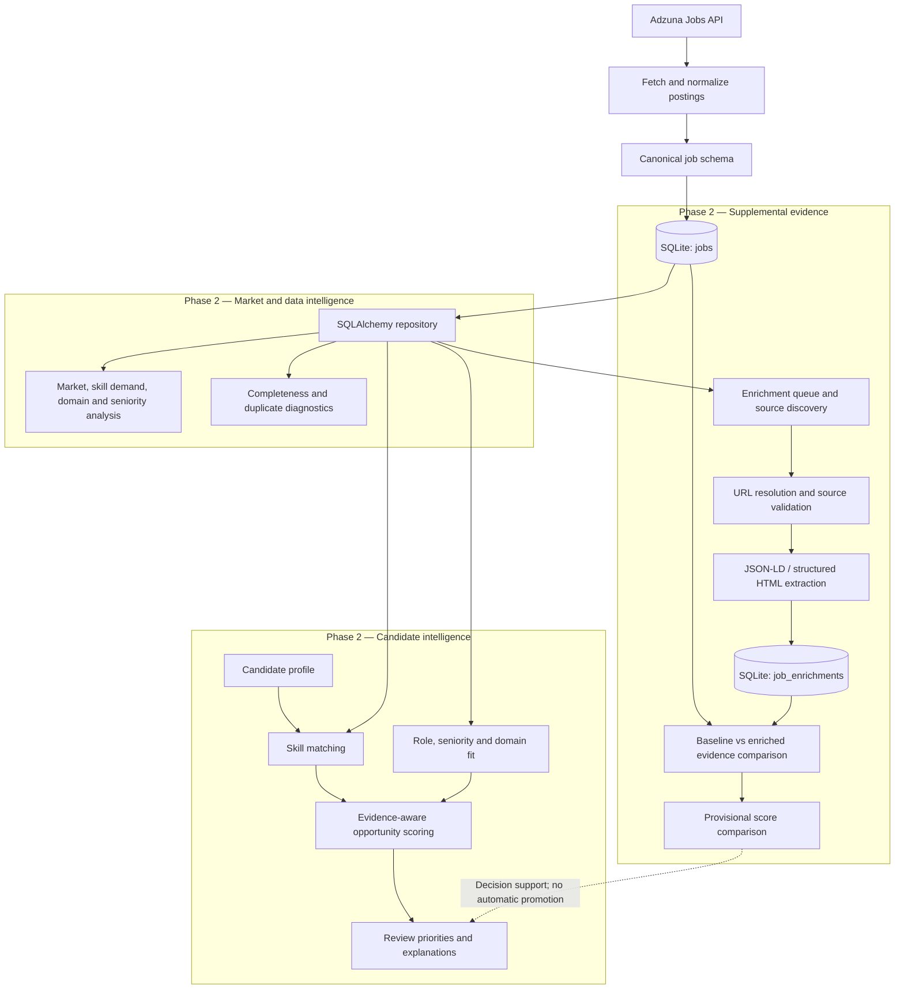

# Job Intelligence & Career Optimization Platform

An evidence-aware Python platform for collecting job postings, analyzing market demand, and evaluating opportunities against a candidate profile. The current implementation covers **Phase 1: Data Engineering Fundamentals** and **Phase 2: Market Analysis & Role Intelligence**.

Instead of ranking jobs by keyword overlap alone, the platform separates **candidate fit**, **strength of supporting evidence**, and **trust in the job-posting source**. Supplemental descriptions can be evaluated without overwriting the original posting.

## Architecture



## Implemented capabilities

### Phase 1 — Data Engineering Fundamentals

- **Adzuna ingestion:** Fetches job listings and handles API response data.
- **Normalization:** Maps external records to a consistent internal job schema.
- **Persistence:** Stores canonical job records in a local SQLite database using SQLAlchemy and a repository layer.
- **Reproducible foundation:** Provides ingestion and database tests to support downstream analytics.

### Phase 2 — Market Analysis & Role Intelligence

| Capability | What it does |
|---|---|
| Market intelligence | Summarizes roles, locations, companies, skill demand, domains, and seniority signals in stored postings. |
| Data quality | Identifies incomplete descriptions, missing evidence, and potential duplicate postings. |
| Candidate profiling | Represents target roles, skills, preferred domains, and target seniority. |
| Job matching | Extracts recognized skills and reports matched and missing qualifications. |
| Opportunity scoring | Combines technical match, evidence strength, role fit, seniority fit, and domain signals. |
| Explainable diagnostics | Reports strengths, concerns, evidence gaps, confidence, and review-priority categories. |
| Source-aware enrichment | Discovers supplemental posting sources, validates provenance, and extracts structured descriptions. |
| Evidence comparison | Compares original and enriched evidence, including provisional scoring, without changing the canonical job record. |

## Scoring and evidence policy

The opportunity scorer uses interpretable, rule-based signals rather than a trained hiring-probability model. Its base weighting is **45% technical ranking, 30% role fit, and 25% seniority fit**, followed by seniority adjustments and a limited domain-evidence bonus. Technical ranking itself accounts for how much relevant skill evidence is actually present in the posting.

Scores are **relative decision-support signals**, not probabilities of getting hired. Short descriptions can produce weak evidence even for potentially suitable jobs.

The enrichment system enforces an important boundary:

- The original posting stays in the **`jobs`** table.
- Supplemental evidence is stored separately in **`job_enrichments`**, with its URL, source type, validation status, extraction method, and extracted content.
- A third-party or unverified source can inform a **provisional comparison** but is not automatically promoted into production scoring.
- The current production-eligibility rule requires `source_type=employer` and `validation_status=verified`; this rule alone does not guarantee factual accuracy.

### Observed enrichment pilot

In a local Tempus AI job-posting experiment, a shortened baseline description yielded an opportunity score of **60.00**. Comparing it with a longer supplemental description yielded a **provisional score of 85.94** (**+25.94**). The source was `third_party` / `review_required`, so the higher score **was not production eligible**. This demonstrates the value of richer evidence and the need to keep source trust separate from model confidence.

## Technology

**Python**, **SQLAlchemy**, **SQLite**, **pytest**, and the **Adzuna Jobs API**. The analytics and scoring components use deterministic extraction and rule-based evaluation; structured enrichment supports **JobPosting JSON-LD** and HTML-based extraction.

## Getting started

The commands below use PowerShell on Windows and assume Python is installed.

```powershell
# Clone the repository
 git clone https://github.com/Rohan-Patil-1/Job-Intelligence-Career-Optimization-Platform.git
 cd Job-Intelligence-Career-Optimization-Platform

# Create and activate a virtual environment
 py -m venv .venv
 .\.venv\Scripts\Activate.ps1

# Install project dependencies
 python -m pip install -r requirements.txt
```

Create a local `.env` using `.env.example` as the reference, and supply your own Adzuna credentials (`ADZUNA_APP_ID` and `ADZUNA_APP_KEY`). Never commit `.env` or the local database.

Initialize the database schema:

```powershell
python -m src.database.init_db
```

The analytics commands operate on jobs already ingested into the local database. An empty database will not produce meaningful market rankings.

## Running analyses

```powershell
# Market and demand analysis
python -m src.analytics.inspect_market
python -m src.analytics.inspect_skill_analysis

# Candidate-aware rankings and review priorities
python -m src.analytics.inspect_job_matches
python -m src.analytics.inspect_opportunities
python -m src.analytics.inspect_review_priorities

# Data quality
python -m src.analytics.inspect_completeness
python -m src.analytics.inspect_duplicates
```

The candidate profile used for local evaluation is defined in `src/profile/default_profile.py`; adjust it to match the intended candidate before interpreting rankings.

For jobs with a stored enrichment record:

```powershell
# Replace 18 with a job ID from your own local database
python -m src.enrichment.run_evidence_comparison --job-id 18
python -m src.enrichment.run_score_comparison --job-id 18
```

These comparisons are exploratory and do not replace the original job description.

## Testing

```powershell
python -m pytest -q
```

**Phase 2 baseline: 183 tests passed** on the development machine. Tests cover ingestion, normalization-related workflows, market analytics, skill extraction, candidate matching, scoring, data quality, source validation, structured extraction, enrichment persistence, and evidence comparisons. This count is a recorded milestone, not a guarantee that every proposed edge case is automated.

See [Testing](docs/phase_2/TESTING.md) and [Test scenarios, approach, and limitations](docs/phase_2/TEST_SCENARIOS_APPROACH_LIMITATIONS.md) for coverage and failure-oriented scenarios.

## Repository layout

```text
src/
  ingestion/       # Adzuna integration and source diagnostics
  processing/      # Job normalization and processing
  database/        # SQLAlchemy models, repositories, initialization
  analytics/       # Market, quality, matching, scoring, diagnostics
  profile/         # Candidate profile and local default configuration
  enrichment/      # Source validation, extraction, evidence comparisons
tests/             # Automated regression tests
docs/
  phase_2/         # Phase 2 design, enrichment, testing, limitations
  PROJECT_DOCUMENTATION.md
  PROJECT_DOCUMENTATION.pdf
```

## Limitations and current scope

- **Source coverage:** The evaluated corpus comes from Adzuna; results are not representative of the entire job market.
- **Incomplete descriptions:** Short or truncated postings can understate skills and affect rankings.
- **Rule-based extraction:** Skill vocabularies and title/domain/seniority heuristics can miss synonyms, context, or ambiguous qualifications.
- **Heuristic weights:** Opportunity scores are not calibrated against hiring outcomes and do not establish eligibility or sponsorship availability.
- **Source reliability:** Third-party listings can be stale, mismatched, or unverifiable; job-page structure and access can change.
- **Evaluation scope:** Automated tests validate implemented behavior, but broad external-source reliability and ranking quality require further empirical evaluation.
- **No application automation:** The current system supports analysis and review; it does not automatically apply to jobs or operate as a deployed production service.

## Documentation

- [Project documentation](docs/PROJECT_DOCUMENTATION.md)
- [Phase 2 architecture and features](docs/phase_2/PHASE_2_MARKET_INTELLIGENCE.md)
- [Enrichment pipeline and source trust](docs/phase_2/ENRICHMENT_PIPELINE.md)
- [Testing guide](docs/phase_2/TESTING.md)
- [Test scenarios, engineering approach, and limitations](docs/phase_2/TEST_SCENARIOS_APPROACH_LIMITATIONS.md)

**Project status:** Phases 1 and 2 implemented and merged into `main`; Phase 3 is not included in this README.
